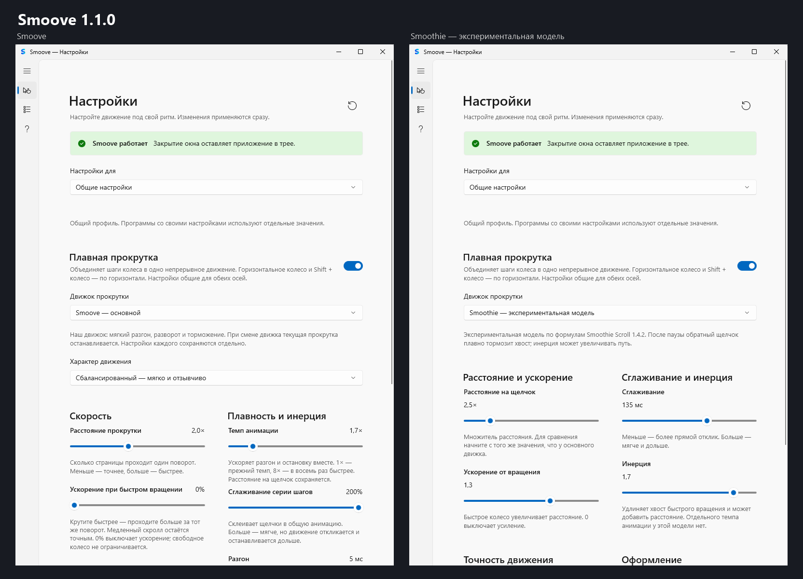

# Smoove

**Плавная прокрутка колесом мыши для Windows 11.** Релиз 1.1.0: два движка, профили программ и улучшенная совместимость.

Smoove объединяет щелчки колеса в непрерывное движение с мягким разгоном и остановкой. Настройте привычную мышь: от быстрого и отзывчивого движения до тягучего и инерционного.

[**Скачать Smoove 1.1.0 — установщик EXE**](https://github.com/starkovskypro-code/Smoove-2.0/releases/download/v1.1.0/Smoove-1.1.0-Setup-win-x64.exe) · [Инструкция](docs/USER-GUIDE.md) · [Сообщить о проблеме](https://github.com/starkovskypro-code/Smoove-2.0/issues)



## Что нового в 1.1.0

- **Два движка:** основной Smoove и экспериментальный Smoothie с независимыми настройками. Исправлено завершение движения второго движка.
- **Профили программ:** общие параметры, свой движок и параметры либо исключение; режим «Только в выбранных программах». Перенос прежних исключений.
- **Горизонтальная прокрутка:** физическое колесо и Shift + колесо в обоих движках; сохранение горизонтального хвоста после отпускания Shift.
- **REAPER:** исправлены обратные отскоки вертикали в проверенных масштабах и завершение горизонтального движения. В MIDI уменьшены чувствительность и количество шагов. Изменение keymap REAPER не требуется.
- **Автоматическая частота** по монитору под указателем (60–500 Гц) и темп основного движка до 8×.
- **Проводник и IDE:** улучшена прокрутка файлов и дерева папок; распознанные встроенные терминалы получают исходный ввод.
- **EXE-установщик** с включёнными .NET и Windows App SDK; сохранение пользовательских настроек.

[Полный список изменений и ограничения](docs/RELEASE-v1.1.0.md). MIDI-редактор REAPER округляет движение по нотным строкам: уменьшенный шаг не означает пиксельную анимацию.

## Видео демонстрация

<video controls="controls" width="800" src="https://github.com/user-attachments/assets/6304ec47-6d37-4b6d-9dc0-8a32601b1950">
  Ваш браузер не поддерживает встроенное видео.
</video>

## Скачать и запустить

1. Скачайте [**Smoove-1.1.0-Setup-win-x64.exe**](https://github.com/starkovskypro-code/Smoove-2.0/releases/download/v1.1.0/Smoove-1.1.0-Setup-win-x64.exe).
2. Запустите установщик и выберите папку.
3. Запустите **Smoove.Settings.exe**.

Установка .NET, Windows App SDK и инструментов разработчика не нужна: библиотеки включены в установщик. Настройки сохраняются локально.

**Требования:** Windows 11 x64, мышь с колесом. ARM64 и Windows 10 не заявлены как проверенные. Установка в профиль пользователя не требует постоянных прав администратора. Установщик не подписан сертификатом издателя; Windows может показать предупреждение SmartScreen.

При переходе с переносимой beta 0.5.0-beta.2 завершите её через трей, затем распакуйте новую сборку в отдельную папку и запустите **Smoove.Settings.exe**. Настройки сохранятся.

## Возможности

- **Общее плавное движение.** Каждый щелчок продолжает траекторию серии, с регулируемым разгоном и торможением.
- **Ускорение от темпа.** Быстрое ручное вращение даёт дополнительный прирост расстояния, медленное остаётся точным.
- **Свободное колесо.** Free-spin не ограничивается отдельным потолком скорости программы.
- **Настройка мягкости и темпа.** Ползунок «Темп анимации» от 0,5× до 8× ускоряет или замедляет всю существующую анимацию, сохраняя расстояние на щелчок и общий характер движения. Также доступны расстояние, ускорение, сглаживание, разгон, инерция и частота событий 60/120/240/500 Гц.
- **Профили программ.** Общие настройки, свой профиль с выбором движка или исключение. Режим «Только в выбранных программах». Правила различают версии приложения по полному пути; старые исключения переносятся автоматически.
- **Горизонтальное колесо.** Сглаживается вместе с Shift + колесом; обе оси используют настройки активного профиля.
- **Адаптация.** «Авто» выбирает частоту по монитору под курсором (примерно 2× частота монитора, 60–500 Гц). Распознанные терминалы внутри IDE получают исходное колесо.
- **Нативные настройки Windows 11.** WinUI 3, Fluent, системная/светлая/тёмная темы.
- **Работа в трее.** Закрытие настроек оставляет фон; «Выход» завершает процесс.
- **Локальное сохранение.** Параметры сохраняются между запусками, без аккаунта и облачного сервиса.

## Как настроить

Доступен список **«Движок прокрутки»**: **Smoove — основной** и **Smoothie — экспериментальная модель**. Второй вариант — самостоятельная C#-реализация формул, восстановленных статическим анализом Smoothie Scroll 1.4.2, без его EXE/DLL. Доступны отдельные расстояние, сглаживание, ускорение и инерция. Настройки обоих движков сохраняются независимо; переключение останавливает текущий хвост. Частота событий и маршруты отправки общие, поэтому это сравнение моделей, а не точная копия всей программы конкурента. Хвост интегрируется точно, чтобы дискретный расчёт не оставлял вечный остаток пути при нулевой скорости.

Начните с **расстояния 1×, ускорения 60%, сглаживания 110% и частоты «Авто»**. Старое фиксированное значение частоты сохраняется при обновлении.

| Хочется | Что изменить |
|---|---|
| Быстрее проходить страницу | Увеличьте «Расстояние прокрутки» |
| Быстрее при учащённом вращении | Увеличьте «Ускорение при быстром вращении» |
| Мягче объединять шаги | Увеличьте «Сглаживание серии шагов» |
| Быстрее реагировать на колесо | Уменьшите разгон и сглаживание |
| Дольше скользить после вращения | Увеличьте «Инерция и остановка» |
| Сравнить более частые обновления | Попробуйте 500 Гц вместо 240 Гц; нагрузка может возрасти |
| Оставить приложению обычное колесо | На странице «Программы» выберите режим «Исключить» |

Частота событий — не FPS программы. Итоговая плавность зависит от приложения, дисплея, мыши и нагрузки.

## Совместимость и ограничения

Общий маршрут проверялся в диагностическом окне, локальной странице Яндекс Браузера и переписке Telegram. Пользователь проекта подтвердил работу своей мышью Logitech MX Master. Это не обещание одинакового результата во всех версиях, программах и областях интерфейса.

- Вертикальное колесо, горизонтальное колесо и Shift + обычное колесо используют настройки активного профиля.  Ctrl/Alt и нажатые кнопки мыши сохраняют исходные действия, например масштабирование.
- Смена окна, значительное перемещение указателя и специальные команды могут остановить хвост. Небольшое дрожание допускается.
- Повышенные и недоступные процессы, UAC и защищённые экраны не обрабатываются. Игры с античитом не заявлены как поддерживаемые.
- Некоторые программы округляют мелкие дельты или используют собственный ввод. При неудобном результате добавьте EXE в исключения.
- Плавный путь для файловой области Проводника, сгруппированных папок и разных видов отображения; [проверки локальной сборки](docs/EXPLORER-SCROLL.md).
- Автозапуск при входе включается пользователем в настройках. Установщик переносит прежнюю запись Smoove при обновлении. Автоматического обновления нет.

## Настройки, обновление и удаление

`%LOCALAPPDATA%\Smoove\settings.json` — общие настройки, профили программ и исключения; рядом сохраняется резервная копия `.bak`. Формат текущих исходников — версия 5. Новые правила работают по точному нормализованному пути, старые имена EXE мигрируют в совместимый формат. Выключенная запись сохраняется, но не действует.

Обновление: закройте Smoove через «Выход» в трее, скачайте новый установщик и выполните обновление. Пользовательские настройки сохраняются.

## Для разработчиков

Актуальная локальная программа находится только в `out/app`. Запуск: `./scripts/Run-Settings.ps1`. Скрипт проверяет исходники и файлы сборки по SHA-256; он не компилирует приложение и не запускает установленную копию. Обновляйте эту папку после правок, затем обновляйте `out/app/local-build.json`.

C#/.NET 10, WinUI 3 и Windows App SDK. Требуются .NET SDK 10 и инструменты WinUI/Windows SDK.

```powershell
dotnet publish src/Smoove.Settings/Smoove.Settings.csproj -c Release -p:Platform=x64 -p:PublishTrimmed=false --self-contained true -o out/app
```

Проверки модели и нативного окна:

```powershell
.\scripts\Test-Prototype.ps1
.\scripts\Test-Settings.ps1
.\scripts\Test-ApplicationProfiles.ps1 -Executable out/app/Smoove.Settings.exe
```

Проверка профилей требует предварительной сборки `dotnet build Smoove.slnx -c Release`. Она использует отдельное тестовое окно, временные настройки и восстанавливает пользовательские настройки после завершения. Для проверки маршрутов колеса запустите `tests/Smoove.Integration/bin/Release/net10.0-windows/Code.exe` с полным путём к отчёту внутри `test-artifacts/`; псевдоним тестового EXE создаётся скриптом проверки профилей для проверки распознавания IDE.

Native/browser/chat проверки управляют тестовыми окнами и курсором; Telegram-проверка работает в текущей переписке без отправки сообщений. См. [результаты](docs/REAL-INPUT-RESULTS.md).

[План](PLAN.md) · [Нативные настройки](docs/SETTINGS-UI.md) · [Исключения](docs/EXCLUSIONS.md) · [Свободное колесо](docs/FREE-SPIN-RESULTS.md) · [Ускорение и частота](docs/TEMPO-AND-PACING.md)
